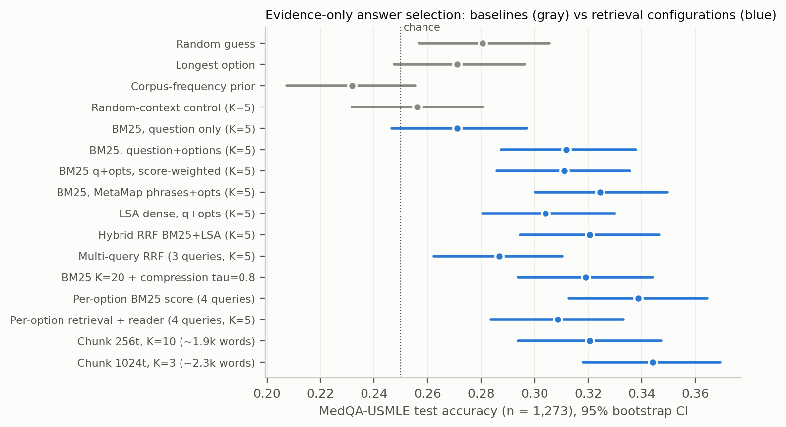
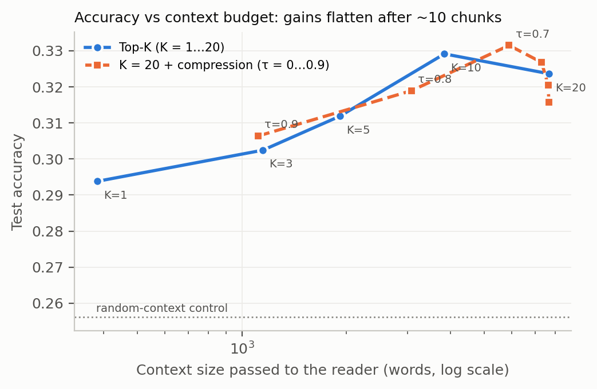
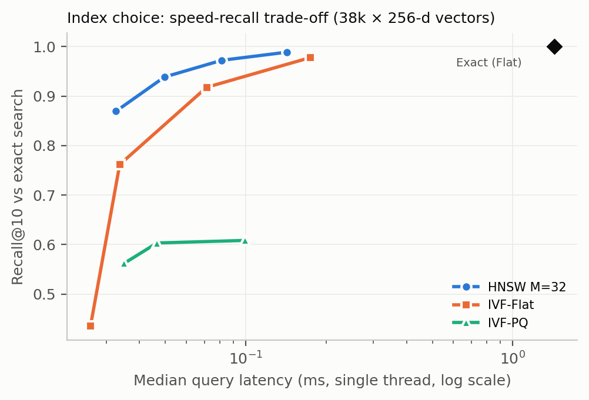

# Does Retrieval Configuration Matter for Medical QA?

**A controlled study of the retrieval stage of RAG on MedQA-USMLE**

Arunika Jain, Ishanika Singh, Vijay Hasanpuri · Manipal University Jaipur
Submitted to **IEEE NICE–TEAS ASIA 2026** (under review)


## What this is

Retrieval-augmented generation (RAG) answers a question by first searching a document collection. This
project studies that **search step** for medical question answering. It asks how chunk size, search method,
query wording, index type and the amount of text kept affect whether the retrieved textbook passages
actually help answer a question.

## Key idea

Earlier comparisons judged answers by how *similar* they sound to a reference answer. Here every question
is a real **4-option USMLE exam question**, so each answer is simply right or wrong. A simple, **non-AI
evidence reader** picks the option best supported by the retrieved passages, so the results measure the
search alone. A **random-passages control** shows whether retrieval helps beyond just adding text.

## Data

| | |
| --- | --- |
| Questions | MedQA-USMLE, 4-option: **1,272 dev** (all setting choices) and **1,273 test** (run once at the end) |
| Corpus | 18 English medical textbooks, **12.9M words**, cut into ~38k chunks of ~512 tokens |
| Leakage audit | 13-gram check of every dev and test question against the textbooks: **0 matches** |

## Main results

Test set, n = 1,273, chance = 25%. Full table: [`results/main_table.txt`](results/main_table.txt).

| Configuration | Test accuracy | vs. random passages (Holm) |
| --- | --- | --- |
| Random passages (control) | 25.6% | — |
| BM25, question only | 27.1% | p = 1.0, no better than the control |
| BM25, question + answer options | **31.2%** | p = 0.017 |
| BM25, MetaMap phrases + options | 32.4% | p = 0.002 |
| Hybrid BM25 + LSA fusion | 32.1% | p = 0.004 |
| Per-option scoring (each option scored with its own search) | **33.9%** | p < 0.001 |

- **Putting the answer options into the search** is the change that makes retrieval useful.
- **Hybrid search and multi-query fusion** did not beat plain BM25; multi-query fusion was worse (28.7%, p = 0.03).
- **Dropping the weakest 60%** of retrieved text cost no accuracy.
- **HNSW** index: about **18× faster** than exact search with almost no loss; **IVF-PQ** is **15× smaller**.
- **Coverage is the limit.** On 60 hand-checked dev questions, even three search methods combined found a
  passage that fully supports the answer for under half of them.



| Context budget | Index trade-off |
| --- | --- |
|  |  |

## Repository structure

| File | Purpose |
| --- | --- |
| `lib.py` | Shared helpers: data loading, metrics, statistical tests (McNemar, bootstrap) |
| `bm25.py` | BM25 implementation |
| `prep.py` | Cuts the textbooks into chunks (256 / 512 / 1,024-token windows) |
| `leakage.py` | 13-gram audit: checks no exam question is copied into the textbooks |
| `exp1_sparse.py` | BM25 experiments: query wording, chunk size, k1 × b parameter grid |
| `exp2_dense_index.py` | LSA dense retrieval, FAISS index comparison (Flat, HNSW, IVF, IVF-PQ), similarity metrics |
| `exp3_answer.py` | End-to-end accuracy with the evidence reader, all configurations, dev and test |
| `analyze.py` | Main results table and significance tests |
| `analyze_labels.py` | Relevance-label metrics (P@3, Hit@3, MRR, nDCG) |
| `figures.py` | Paper figures |
| `label/` | Relevance grades (`labels.txt`: question, chunk, grade 0/1/2) and which retriever returned each chunk (`meta.json`). The grading sheets are not included because they contain textbook text |
| `results/` | All result CSV/JSON/log files (chunk IDs only, no textbook text) |
| `RESULTS.md` | Written summary of every experiment |
| `stage2_llm.py`, `analyze_stage2.py`, `stage2_colab.ipynb` | Next stage: a real LLM reader (Qwen2.5-3B on a free Colab GPU, or any OpenAI-compatible API). Implemented, not run yet |

## Getting the data

The questions and textbooks are **not included** in this repository; they are distributed under the
MedQA research licence.

1. Download MedQA from the official repository: **[github.com/jind11/MedQA](https://github.com/jind11/MedQA)**
   (follow its link to `data_clean`).
2. Point the code to it:

```bash
export MEDQA_DIR=/path/to/data_clean
```

Never commit `data/`, chunk files or textbook text. The `.gitignore` excludes them.

## How to run

```bash
pip install -r requirements.txt
export MEDQA_DIR=/path/to/data_clean

python prep.py && python leakage.py
python exp1_sparse.py && python exp2_dense_index.py
python exp3_answer.py dev 1.5 0.75 && python exp3_answer.py test 1.5 0.75
python analyze.py && python figures.py
```

Stage 2 (LLM reader): open `stage2_colab.ipynb` in Google Colab.

## Status

- **Retrieval study:** complete.
- **LLM stage:** implemented, not yet run.
- **Paper:** under review.

## Use of AI tools

AI tools assisted with writing the code and with grading the relevance labels.

## Citation

```bibtex
@inproceedings{jain2026retrieval,
  title     = {Does Retrieval Configuration Matter for Medical {QA}? A Controlled Retrieval-Stage Study of {RAG} on {MedQA-USMLE}},
  author    = {Jain, Arunika and Singh, Ishanika and Hasanpuri, Vijay},
  booktitle = {IEEE NICE--TEAS ASIA 2026 (under review)},
  year      = {2026}
}
```

## Licence

Code: [MIT](LICENSE). The MedQA dataset and textbooks have their own terms.
